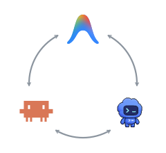

<p align="center">
  
</p>

<h1 align="center">codex-mcp-bridge</h1>

<p align="center">
  <a href="https://www.npmjs.com/package/@minhspark/codex-mcp-bridge"></a>
  <a href="https://www.npmjs.com/package/@minhspark/codex-mcp-bridge"></a>
  <a href="https://www.npmcharts.com/compare/%40minhspark%2Fcodex-mcp-bridge?minimal=true"></a>
  <br />
  <a href="https://github.com/buidangminh23/codex-mcp-bridge/network/dependents"></a>
  <a href="https://skills.sh/buidangminh23/codex-mcp-bridge/codex-bridge"></a>
  <a href="https://buidangminh23.github.io/codex-mcp-bridge/"></a>
  <a href="LICENSE"></a>
</p>

Send prompts and replies between **Claude and Codex**, keeping each conversation in its own app. Supports Windows, macOS, and Linux; native Desktop integration supports Windows and macOS.

https://github.com/user-attachments/assets/98b23989-826f-4d7d-9dcb-ad7dd2739095

## Installation

```bash
npm install -g @minhspark/codex-mcp-bridge@latest
```

Requires **Node.js 22+**. In Windows PowerShell, use `npm.cmd` instead of `npm`. Run the same command to update; reconnect MCP servers if their settings or installation paths changed.

On macOS or Linux you can install with [Homebrew](https://github.com/buidangminh23/homebrew-tap) instead, which brings its own Node.js:

```bash
brew install buidangminh23/tap/codex-mcp-bridge
```

Update with `brew upgrade codex-mcp-bridge`. The installers record Homebrew's stable `opt` paths, so registrations keep working after an upgrade and running bridges reload the new version. Keep one install channel: whichever of npm or Homebrew comes first on `PATH` provides the commands.

[Windows](#windows-powershell) · [macOS](#macos-terminal) · [Linux / WSL](#linux--wsl-bash) · [ChatGPT plugin](#chatgpt-plugin)

### Windows (PowerShell)

Install and sign in to [Codex Desktop](https://developers.openai.com/codex/app) and [Claude Desktop](https://claude.com/download). Save the project in Codex Desktop and open the same directory in Claude Desktop's **Code tab**. Have the Codex and Claude Code CLIs available.

If the Codex CLI is missing, run `winget install --id OpenAI.Codex --exact`, open a new terminal, then run `codex.exe login`.

```powershell
$env:CODEX_EXE = (Get-Command codex.exe).Source
codex-native-relay-install.cmd --desktop-tasks
codex-mcp-bridge-install.cmd --desktop-tasks
$env:CODEX_BRIDGE_DESKTOP_TASKS = "1"
claude-mcp-bridge-install.cmd
```

Next: [register Claude Code](#register-claude-code), add [relay pipe forwarding](#native-relay-pipe-forwarding), then [verify](#verify-the-installation).

### macOS (Terminal)

Install and sign in to Codex Desktop and Claude Desktop. Save the project in Codex Desktop and open the same directory in Claude Desktop's **Code tab**.

```bash
npm install -g @openai/codex@latest
codex login
codex-native-relay-install --desktop-tasks
codex-mcp-bridge-install --desktop-tasks
CODEX_BRIDGE_DESKTOP_TASKS=1 claude-mcp-bridge-install
```

Keep bootstrap enabled on the first relay install. Next: [register Claude Code](#register-claude-code), add [relay pipe forwarding](#native-relay-pipe-forwarding), then [verify](#verify-the-installation).

### Register Claude Code

Claude Desktop and Claude Code have separate MCP registrations. If `claude --version` is unavailable, [install Claude Code](https://code.claude.com/docs/en/setup) first. For a new registration, replace the example project path below with the actual directory. Preserve custom settings if `codex-bridge` is already registered.

<details>
<summary>Windows PowerShell</summary>

```powershell
$bridgeRoot = Join-Path ((npm.cmd root -g).Trim()) '@minhspark/codex-mcp-bridge'
claude mcp add --scope user codex-bridge `
  -e "CODEX_BIN=$((Get-Command codex.exe).Source)" `
  -e CODEX_BRIDGE_DESKTOP_TASKS=1 `
  -e CODEX_BRIDGE_AUTOSTART=0 `
  -e CODEX_BRIDGE_THREAD_POLICY=roots `
  -e "CODEX_BRIDGE_ALLOWED_ROOTS=C:\Projects\YourProject" `
  -- (Get-Command node.exe).Source (Join-Path $bridgeRoot 'src/mcp-supervisor.mjs') index.mjs
```

</details>

<details>
<summary>macOS Terminal</summary>

```bash
bridge_root="$(npm root -g)/@minhspark/codex-mcp-bridge"
claude mcp add --scope user codex-bridge \
  -e CODEX_BIN="$(command -v codex)" \
  -e CODEX_BRIDGE_DESKTOP_TASKS=1 \
  -e CODEX_BRIDGE_AUTOSTART=0 \
  -e CODEX_BRIDGE_THREAD_POLICY=roots \
  -e CODEX_BRIDGE_ALLOWED_ROOTS="$HOME/YourProject" \
  -- "$(command -v node)" "$bridge_root/src/mcp-supervisor.mjs" index.mjs
```

For a Homebrew install, use the stable paths instead of `npm root -g` and `command -v node`:

```bash
bridge_root="$(brew --prefix)/opt/codex-mcp-bridge/libexec/lib/node_modules/@minhspark/codex-mcp-bridge"
node_bin="$(brew --prefix)/opt/node/bin/node"
```

and end the command with `-- "$node_bin" "$bridge_root/src/mcp-supervisor.mjs" index.mjs`.

</details>

Separate multiple allowed directories with `;` on Windows or `:` on macOS/Linux.

### Native relay pipe forwarding

On Windows and macOS, `codex-native-relay-install` adds this to the relay's entry in `~/.codex/config.toml` (or `$CODEX_HOME/config.toml`) and keeps its other settings:

```toml
[mcp_servers.codex-native-relay]
env_vars = ["CODEX_APP_TOOLS_PIPE_PATH"]
```

If you register the relay by hand, add the same line and append the variable name if `env_vars` already exists. Only the name is saved, never the temporary pipe path. Restart Codex Desktop after active work finishes so it relaunches the relay.

### Linux / WSL (Bash)

Use Node.js 22+ and signed-in Codex and Claude Code CLIs under the same Linux user. This mode uses a local app-server; native Desktop integration requires Windows or macOS.

<details>
<summary>CLI registration commands</summary>

```bash
npm install -g @openai/codex@latest
codex login
CODEX_BRIDGE_DESKTOP_TASKS=0 claude-mcp-bridge-install
bridge_root="$(npm root -g)/@minhspark/codex-mcp-bridge"
claude mcp add --scope user codex-bridge \
  -e CODEX_BIN="$(command -v codex)" \
  -e CODEX_BRIDGE_DESKTOP_TASKS=0 \
  -e CODEX_BRIDGE_AUTOSTART=1 \
  -e CODEX_BRIDGE_THREAD_POLICY=roots \
  -e CODEX_BRIDGE_ALLOWED_ROOTS="$HOME/YourProject" \
  -- "$(command -v node)" "$bridge_root/src/mcp-supervisor.mjs" index.mjs
```

Replace `$HOME/YourProject` with the actual project directory. WSL and Windows use separate paths and registrations.

</details>

### Verify the installation

Reconnect the affected MCP servers in the actual client tasks; Claude Code provides `/mcp`. Run these **MCP tools** inside the apps:

| Client | Tool |
|---|---|
| Claude Code | `codex_bridge_status` |
| Codex | `claude_bridge_status` |
| Codex Desktop | `native_relay_status` |

Send a short message and confirm its reply **in both directions**. Registration alone does not prove delivery.

## Use

- **Claude → Codex:** “Send this review to my Codex task in this project and wait for its reply.”
- **Codex → Claude:** “Send this result to my Claude Desktop Code session in this project.”
- **New work:** “Create a new Codex conversation for this feature and send the brief there.”

Continue unfinished work with its original `threadId`. For an authorized new Desktop task, use `delegate_to_codex` or `start_codex_thread` with a fresh UUID `requestId`; retain that ID on retries. If a send times out, use `wait_codex_reply` with the original `deliveryId` before retrying the message.

[Daily handoffs](docs/daily-handoffs.md) · [Project permissions](docs/project-onboarding.md) · [All tools and settings](https://github.com/buidangminh23/codex-mcp-bridge/blob/main/REFERENCE.md)

## ChatGPT plugin

[Open Codex Bridge](https://codex-mcp-bridge.buidangminh23.chatgpt.site) to connect ChatGPT to a selected project on a Windows or macOS computer. After installing the package and native relay above, pair the connector:

```bash
codex-sites-connector --pair --site https://codex-mcp-bridge.buidangminh23.chatgpt.site --roots "/absolute/project/path"
```

In PowerShell use `codex-sites-connector.cmd` and a Windows path such as `C:\Projects\YourProject`. Open the printed pairing URL, sign in, and select **Connect this computer**. Keep Codex Desktop and the connector running; use `codex-sites-connector` to reconnect later.

The MCP endpoint is `https://codex-mcp-bridge.buidangminh23.chatgpt.site/mcp`. Plugin availability follows [OpenAI's Sites access rules](https://help.openai.com/en/articles/20001547-hosting-a-plugin-with-chatgpt-sites); a public directory listing is not claimed.

<details>
<summary>Hosted data and privacy</summary>

The service is operated by Bui Dang Minh on OpenAI Sites. It stores a Site-scoped account ID, connector ID and token hash, timestamps, tool arguments (including prompts), and returned Desktop results. The operator can access these records. Local credentials and receipts stay in `~/.codex/sites-bridge`.

Dispatch expires after two minutes; operation history remains stored. Disconnecting revokes the connector and cancels queued work, but does not erase history or stop dispatched tasks. For deletion requests, contact the operator through the repository's support link without posting private content publicly. The hosted Worker implements no advertising or analytics collection.

</details>

## Troubleshooting

- **Command missing:** open a new terminal and check Node.js 22+ and the global npm directory (or Homebrew's `bin`) on PATH.
- **PowerShell blocks scripts:** use `npm.cmd`, installer `.cmd` launchers, and `codex.exe`.
- **No sessions or wrong project:** open the intended Claude **Code** session and use the exact project directory saved in Codex Desktop.
- **Relay unavailable:** check [pipe forwarding](#native-relay-pipe-forwarding), reconnect, and run `native_relay_status` in the task.
- **Timeout or unconfirmed send:** inspect the original task or receipt before sending again.

[More fixes](https://github.com/buidangminh23/codex-mcp-bridge/blob/main/REFERENCE.md#troubleshooting) · [Report an issue](https://github.com/buidangminh23/codex-mcp-bridge/issues)

## Optional active-install statistics

Usage reporting is **off by default**. Manage it with `codex-mcp-bridge telemetry enable`, `telemetry status`, or `telemetry disable`. Reports contain a random installation ID, UTC day, version, and OS; no chat content, paths, account identity, or credentials. `DO_NOT_TRACK=1` or `CODEX_BRIDGE_TELEMETRY=0` disables reporting. Disabling removes the local ID; submitted records expire after 90 days during ingestion.

[Analytics dashboard](https://buidangminh23.github.io/codex-mcp-bridge/) · [Release notes](https://github.com/buidangminh23/codex-mcp-bridge/releases) · [Contributing](CONTRIBUTING.md) · [MIT license](LICENSE)
