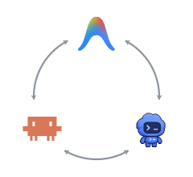

<p align="center">
  
</p>

<h1 align="center">codex-mcp-bridge</h1>

<p align="center">
  <a href="https://www.npmjs.com/package/@minhspark/codex-mcp-bridge"></a>
  <a href="https://www.npmjs.com/package/@minhspark/codex-mcp-bridge"></a>
  <a href="https://www.npmcharts.com/compare/%40minhspark%2Fcodex-mcp-bridge?minimal=true"></a>
  <br />
  <a href="https://github.com/buidangminh23/codex-mcp-bridge/network/dependents"></a>
  <a href="https://skills.sh/buidangminh23/codex-mcp-bridge/codex-bridge"></a>
  <a href="https://buidangminh23.github.io/codex-mcp-bridge/"></a>
  <a href="LICENSE"></a>
</p>

Connect **Claude, Codex, and Antigravity** through MCP using native Desktop handoffs or independent CLI background workers. Native handoffs preserve each app's conversation identity and permission checks; workers have separate sessions and enforce provider permissions and project authorization. Supports Windows, macOS, and Linux; native Desktop integration supports Windows and macOS.

The **background worker relay** supports all six directions between Codex, Claude and Antigravity CLI workers, independently of Desktop responsiveness. The optional **native Antigravity bridge** connects existing Desktop conversations in the same project and offers separate bridge-owned CLI streaming sessions. Native App replies remain in the App. [Background workers](#independent-background-workers) · [Antigravity native and streaming-session limits](#antigravity-app-and-cli).

https://github.com/user-attachments/assets/98b23989-826f-4d7d-9dcb-ad7dd2739095

## Installation

One global npm command installs the package, configures the local Claude, Codex and Antigravity bridges, and installs the independent worker relay. Native handoffs require the selected Desktop apps; background work requires the selected provider CLIs and their own authentication. Setup preserves existing project restrictions and custom settings; it does not sign in, grant workspace trust, change permission modes, or restart running apps.

### Package — npm

**macOS / Linux / WSL**

```bash
npm install -g @minhspark/codex-mcp-bridge@latest --allow-scripts=@minhspark/codex-mcp-bridge --foreground-scripts
```

**Windows PowerShell**

```powershell
npm.cmd install -g @minhspark/codex-mcp-bridge@latest --allow-scripts=@minhspark/codex-mcp-bridge --foreground-scripts
```

Requires **Node.js 22.13+**. Use `.cmd` for this package's commands in Windows PowerShell. **Every release uses this same single install/update command.** It updates the package, applies the managed bridge settings across Claude, Codex and Antigravity, configures the independent background worker relay, and verifies saved registrations and service activation separately. Comprehensive setup migrates historical automatic Codex navigation to `CODEX_BRIDGE_OPEN_IN_APP=0`, enables Claude's native background preference and updates Antigravity's existing Windows background preference where supported. Accounts, project grants, unrelated custom registrations and existing permission denials remain unchanged. Setup adds only the four worker-relay communication grants required by headless Antigravity; it does not enable broad permission bypasses. If a native Codex CLI is missing, setup installs a pinned official `@openai/codex` package in the current user's `~/.config/GptClaudeBridge/tools` (or the corresponding `XDG_CONFIG_HOME` path); no separate CLI install command is needed.

### Independent background workers

`worker_status`, `list_workers`, `send_to_worker` and `read_worker_delivery` address separate Codex, Claude and Antigravity CLI workers. The `worker-relay` command provides status, list, send and receipt-read operations from a terminal. All six worker directions are supported: Codex ↔ Claude, Codex ↔ Antigravity and Claude ↔ Antigravity. A native handoff still addresses its original native task; an uncertain native send is never silently replayed through a CLI worker.

The service and worker processes run independently of Desktop hosts. Submitted background jobs and worker-to-worker communication can continue while those apps are closed or frozen. A frozen window cannot accept new user input or display new results until it responds again. Submit authorized background work or inspect its receipts through `worker-relay` in a terminal or another responsive MCP client; this does not repair or reopen the frozen UI.

The operating system and per-user service must be running, the selected CLI must be installed and authenticated, and the project must be authorized. Provider access, network connectivity, quota and tool permissions still apply. Setup supplies a missing Codex CLI; install Claude Code and `agy` separately when those workers are needed. Sleep, shutdown, a disabled service or a provider failure can prevent execution.

`authentication-unverified` with `canAcceptWork: true` is an informational state for a CLI without a supported authentication probe. It is not an authentication failure. Actual failed jobs have a durable diagnostic receipt. Keep the original request ID when inspecting or retrying an uncertain submission; after a terminal `failed` receipt confirms `not_sent`, fix the reported cause before creating a new authorized request.

The package update configures per-user startup: Task Scheduler on Windows, a LaunchAgent on macOS and a systemd user service on Linux. It starts the service without opening apps or chats, preserves intentional disabled choices, and drains active jobs before adopting updated code. `worker-relay status` reports transport availability, provider authentication checks and recent errors separately. A saved configuration is not proof of live activation or model access.

CLI authentication is separate from Desktop sign-in. Workers use each provider's official credential handling; the bridge does not copy Desktop tokens. Codex and Claude use ephemeral CLI sessions. Antigravity starts a fresh CLI-owned conversation and never resumes a Desktop conversation; its CLI may retain history according to provider behavior and uses its shared MCP inventory. Setup preserves other MCP entries and effective provider permissions. No worker opens or navigates that history.

Background dispatch uses the existing shared project-policy file. Select a project explicitly with `bridge-projects allow-project <absolute-project-path>` if it is not already authorized; updates preserve grants and revocations. Each child delegation stays in the same canonical project. Existing provider permissions remain enforced, including denials that prevent unattended execution.

Keep the same request UUID for retries and read its durable receipt. Queued work can survive relay restarts; work that might already have reached a worker is marked unknown and is never replayed automatically. Failure reports remain readable after the original window closes, with error/cause codes, delivery certainty and report IDs. Errors from tool calls appear in their Claude/Codex/Antigravity tool results; this package does not create a separate Desktop popup or reopen a chat to show them.

Worker delegation is bounded. `WORKER_DELEGATION_CAPACITY` means the destination has no free execution slot and that delegation was not sent or queued behind waiting workers. Inspect or finish existing delegated work before retrying the same unsent request. Queue and delegation limits are reported explicitly.

`--allow-scripts=@minhspark/codex-mcp-bridge` authorizes only this package's setup hook. npm versions that block install scripts by default need this flag; a plain install works only when the hook is allowed. `--foreground-scripts` displays configuration progress and failures that npm otherwise hides. If npm prints `1 package had install scripts blocked`, rerun the recommended command or run `codex-bridge-setup` explicitly.

| Client | Installed entry | Purpose |
| --- | --- | --- |
| Claude Code | `codex-bridge` | Native Codex Desktop handoffs on Windows/macOS; local app-server mode on Linux |
| Claude Desktop shared connectors | `codex-bridge-desktop` | Local Codex app-server sessions from ordinary chat |
| Codex | `claude-bridge` | Send to Claude and observe replies |
| Codex Desktop, Windows/macOS | `codex-native-relay` | Native delivery, pipe forwarding, and relay executor bootstrap |
| Codex and Claude Code | `antigravity-bridge` | Send to Antigravity App or bridge-owned CLI sessions |
| Antigravity | `agent-bridge` and `codex-bridge` sidecar | Outbound agent messages and native App connectivity |
| Independent CLI workers | `worker-relay` | Authorized background jobs and all six worker-to-worker directions |

For native Claude-to-Codex handoffs, use an existing native Claude **Code** session and the same local project saved in Codex Desktop. The shared `codex-bridge-desktop` connector has its own legacy route; it does not establish a native Code sender identity. Setup applies saved configuration without opening or restarting apps. Saved configuration is not proof of a live connection; available supervisors reload compatible workers when idle. Complete [verification](#verify-the-installation) with the tools already available in the actual clients. If a native host is unloaded, report the diagnostic instead of opening chats to load a relay.

Automatic setup runs only for a **global npm install**. Local `npm install` and `npm ci` do not change app settings. Set `CODEX_BRIDGE_SKIP_SETUP=1`, or pass `--ignore-scripts`, to install the package without configuring apps. The optional [workflow skill](#workflow-skill--npx-skills), VS Code preview, and hosted ChatGPT pairing retain their separate setup steps.

### Setup recovery and checks

If an app configuration step fails, setup and the global install return a nonzero exit with the failing component. Correct its reported issue and rerun the update command above, or rerun configuration on an existing installation:

```bash
codex-bridge-setup
```

On Windows use `codex-bridge-setup.cmd`. `codex-mcp-bridge setup` is an equivalent entry point. Repeated setup reapplies managed bridge settings and reports conflicts rather than overwriting unrelated registrations. `configured: true` confirms saved configuration; `liveVerified: false` means running clients have not been verified to load it. Setup never opens an app or chat, uses Computer Use, or interrupts active work to load a relay. Missing or unsupported native background preferences are reported separately.

```bash
codex-bridge-setup --check
codex-bridge-setup --dry-run
```

`--check` inspects saved registrations without sending work. Explicit setup and `--check` exit with a nonzero status when configuration is incomplete. `--dry-run` lists planned components and configuration paths without downloads or writes. Add `--json` for structured output, or `--no-download` to require an already available Codex CLI. Setup never labels a saved registration as a verified live exchange.

### Package — Homebrew

On macOS or Linux you can install with [Homebrew](https://github.com/buidangminh23/homebrew-tap) instead, which brings its own Node.js:

```bash
brew install buidangminh23/tap/codex-mcp-bridge
```

**Homebrew — update**

```bash
brew upgrade codex-mcp-bridge
```

Run `codex-bridge-setup` after installing through Homebrew. The installers record Homebrew's stable `opt` paths, so registrations keep working after an upgrade and running bridges reload compatible code changes. Keep one install channel: whichever of npm or Homebrew comes first on `PATH` provides the commands.

[Windows](#windows-powershell) · [macOS](#macos-terminal) · [Claude Code](#register-claude-code) · [Antigravity](#antigravity-app-and-cli) · [VS Code](#vs-code-extensions--windows-preview) · [Linux / WSL](#linux--wsl-bash) · [NPX Skills](#workflow-skill--npx-skills) · [ChatGPT plugin](#chatgpt-plugin)

| Integration | Setup |
| --- | --- |
| Claude Desktop Code → Codex Desktop | Automatic native setup on Windows/macOS |
| Claude Code CLI → local Codex app-server | Automatic on Linux; optional manual CLI mode on Windows/macOS |
| Claude Desktop shared MCP → local Codex app-server | Automatic `codex-bridge-desktop` registration |
| Codex → Claude Desktop Code | Automatic `claude-bridge` registration |
| Codex / Claude Desktop Code → Antigravity App or CLI | Automatic Antigravity registrations |
| Antigravity App → Codex / Claude Desktop Code | Automatic outbound registration and sidecar |
| Codex ↔ Claude ↔ Antigravity CLI workers | Automatic independent relay setup; provider CLIs, authentication and project grants required |
| Claude Code ↔ Codex inside VS Code | Separate Windows preview registrations below |
| ChatGPT → paired Codex Desktop | Hosted plugin plus `codex-sites-connector --pair` |

### Antigravity App and CLI

The global npm setup registers all Antigravity components, including the independent `worker-relay` MCP entry and its four scoped CLI communication grants. Install and sign in to the Antigravity App for native conversations or the `agy` CLI for CLI work. The following commands configure only the native bridge and its legacy streaming-session tools; use the global setup above to configure the independent worker service as well:

```bash
antigravity-mcp-bridge-install --all
```

**Windows PowerShell — all native bridge components**

```powershell
antigravity-mcp-bridge-install.cmd --all
```

**Codex → Antigravity App / CLI**

```bash
antigravity-mcp-bridge-install --codex
```

**Claude Desktop Code → Antigravity App / CLI**

```bash
antigravity-mcp-bridge-install --claude
```

**Antigravity App sidecar and outbound bridge**

```bash
antigravity-mcp-bridge-install --desktop
```

**Preview the installation without changing configuration**

```bash
antigravity-mcp-bridge-install --all --dry-run
```

Use `.cmd` for each command on Windows. `--all` includes the Codex, Claude and Antigravity native bridge components; the individual commands are alternatives when only some clients are needed. The installer preserves unrelated configuration and native permissions. Managed MCP supervisors adopt compatible updates when idle; an old direct process remains on its loaded version until the host reconnects normally. No app or chat is opened to force readiness. Antigravity launches its own sidecar from `~/.gemini/config/sidecars/codex-bridge/sidecar.json`; do not run that sidecar manually or copy authentication environment variables between processes.

The `agy` CLI must be installed and signed in separately. The legacy `start_antigravity_cli_session` tool creates streaming sessions owned by the calling bridge process; independent background work instead uses `send_to_worker` with `agent: "antigravity"`. There is no separate `--cli` installer flag. Set `ANTIGRAVITY_CLI_BIN` to the absolute `agy` executable path in the MCP server environment if automatic discovery cannot find it.

| Tool | Behavior |
| --- | --- |
| `antigravity_bridge_status` | Reports native sidecar connectivity, CLI capabilities, and the separate outbound Desktop route. Outbound readiness requires `agent_bridge_status` inside Antigravity. |
| `list_antigravity_conversations` | Lists the selected surface in the verified sender's exact project directory. |
| `send_to_antigravity_conversation` | Sends to an exact existing App conversation or a CLI session owned by this bridge. |
| `start_antigravity_cli_session` | Starts an explicitly authorized CLI streaming session with its initial prompt. |
| `read_antigravity_delivery` | Reads the original receipt without resending. |
| `close_antigravity_cli_session` | Closes an idle CLI session owned by the sender. |

For these native bridge and legacy streaming-session tools, generate a new `requestId` UUID for each intentional delivery and reuse it only when inspecting or retrying that same delivery. A pending or unknown receipt must be inspected before further action. Receipts survive process restarts; live streaming CLI processes do not. A CLI timeout retains its conversation identity for inspection. No mode or permission-bypass flag is added; headless tool requests requiring interaction may be denied by Antigravity.

The App adapter uses the official [sidecar `agentapi`](https://antigravity.google/docs/sidecars), verifies native workspace metadata, and refuses busy or ambiguous destinations. An App `accepted` receipt confirms native acceptance, not a completed agent reply. Its response remains in the exact native App conversation and can be read when that UI is responsive. The CLI adapter uses the official [streaming JSON interface](https://antigravity.google/docs/cli/headless) and returns the agent's final result. It creates bridge-owned headless sessions; it does not attach to an already running interactive terminal. The two surfaces never substitute for one another.

The installer also registers **agent-bridge inside Antigravity Desktop** in `~/.gemini/config/mcp_config.json`. Once the host has loaded that registration, use the tools available in the intended Antigravity conversation: check `agent_bridge_status`, call `list_agent_tasks` for `codex` or `claude`, then use `send_to_agent_task` with the exact destination ID, project directory, prompt, and a fresh request UUID. Claude destinations also require their native `taskId`. Read `read_agent_delivery` without resending; `read_agent_task` reads the selected Codex task's response or Claude's native task metadata.

Native outbound calls verify Antigravity's per-call MCP metadata, Desktop process ancestry, native workspace/project, and effective permission settings. The sender is attributed as Antigravity. Codex keeps its native task settings; Claude's inbound policy and permission-class checks remain in effect. A socket write to Claude is `sent_unconfirmed`, not acceptance or completion. After MCP restart, a saved receipt remains available but live Claude reply tracking may be unavailable; inspect the exact native task before further action.

If a caller says the bridge only supports one-way messaging, compare its loaded version with the installed package: older initialization instructions incorrectly denied the separate native outbound route. A managed worker can reload when idle; an old direct MCP process requires a normal host reconnection. An unavailable inbound sidecar does not prove that the App is closed or that outbound messaging is unsupported. Use available `agent_bridge_status` diagnostics to verify the native outbound route independently, and `worker_status` for the independent workers.

Native outbound support targets existing local Codex tasks and live Claude Desktop Code sessions in the same project. That route rejects nested Antigravity callers and CLI callers claiming Desktop identity; App conversation creation and automatic App reply forwarding are not implemented. These native limits do not restrict the separately authorized CLI workers, which communicate through `worker-relay` in all six directions. Windows Desktop is the native live verification platform; macOS ancestry has unit coverage and Linux native outbound host verification fails closed. The existing Codex↔Claude native bridge remains separate. Use `antigravity-mcp-bridge-install --all --remove` to remove only the native bridge registrations; independent worker configuration and delivery receipts are retained.

### Windows (PowerShell)

Install and sign in to [Codex Desktop](https://developers.openai.com/codex/app) and [Claude Desktop](https://claude.com/download). Save the project in Codex Desktop and open the same directory in Claude Desktop's **Code tab**. The [global npm command](#package--npm) configures both apps, the shared `codex-bridge-desktop` connector, and Antigravity. Then [verify](#verify-the-installation).

<details>
<summary>Optional manual native setup</summary>

These advanced commands require an existing Codex CLI on PATH. If it is missing, use `codex-bridge-setup.cmd` to resolve or install it automatically. A separately managed CLI can instead be installed with `winget install --id OpenAI.Codex --exact` and signed in with `codex.exe login`.

```powershell
$env:CODEX_EXE = (Get-Command codex.exe).Source
codex-native-relay-install.cmd --desktop-tasks
$env:CODEX_BRIDGE_DESKTOP_TASKS = "1"
claude-mcp-bridge-install.cmd
```

For manual setup, also [register Claude Code](#register-claude-code) and check [relay pipe forwarding](#native-relay-pipe-forwarding).

</details>

### macOS (Terminal)

Install and sign in to Codex Desktop and Claude Desktop. Save the project in Codex Desktop and open the same directory in Claude Desktop's **Code tab**. Run the [global npm command](#package--npm), then [verify](#verify-the-installation). Setup selects the trusted app-bundled relay runtime when available and initializes the relay executor.

<details>
<summary>Optional manual native setup</summary>

```bash
npm install -g @openai/codex@latest
codex login
codex-native-relay-install --desktop-tasks
CODEX_BRIDGE_DESKTOP_TASKS=1 claude-mcp-bridge-install
```

Keep bootstrap enabled on the first manual relay install. Also [register Claude Code](#register-claude-code) and check [relay pipe forwarding](#native-relay-pipe-forwarding).

</details>

### Register Claude Code

Global npm setup creates the user-level Code registration automatically. Claude Desktop and Claude Code have separate MCP registrations. The commands below are optional manual alternatives; they require the [Claude Code CLI](https://code.claude.com/docs/en/setup). Replace the example project path with the actual directory and preserve custom settings if `codex-bridge` is already registered.

Native Desktop handoffs require a verified Claude Desktop **Code** session. A shared Desktop chat MCP registration cannot establish that sender identity. Automatic setup safely renames a recognized shared `codex-bridge` entry to `codex-bridge-desktop`, retaining its contents, so it cannot shadow the Code registration. A conflicting target or unknown entry is reported for review. For manual edits, close Claude first and keep the two entry names distinct.

<details>
<summary>Windows PowerShell</summary>

```powershell
$bridgeRoot = Join-Path ((npm.cmd root -g).Trim()) '@minhspark/codex-mcp-bridge'
claude mcp add --scope user codex-bridge `
  -e "CODEX_BIN=$((Get-Command codex.exe).Source)" `
  -e CODEX_BRIDGE_DESKTOP_TASKS=1 `
  -e CODEX_BRIDGE_AUTOSTART=0 `
  -e CODEX_BRIDGE_THREAD_POLICY=roots `
  -e "CODEX_BRIDGE_ALLOWED_ROOTS=C:\Projects\YourProject" `
  -- (Get-Command node.exe).Source (Join-Path $bridgeRoot 'src/mcp-supervisor.mjs') index.mjs
```

</details>

<details>
<summary>macOS Terminal</summary>

```bash
bridge_root="$(npm root -g)/@minhspark/codex-mcp-bridge"
claude mcp add --scope user codex-bridge \
  -e CODEX_BIN="$(command -v codex)" \
  -e CODEX_BRIDGE_DESKTOP_TASKS=1 \
  -e CODEX_BRIDGE_AUTOSTART=0 \
  -e CODEX_BRIDGE_THREAD_POLICY=roots \
  -e CODEX_BRIDGE_ALLOWED_ROOTS="$HOME/YourProject" \
  -- "$(command -v node)" "$bridge_root/src/mcp-supervisor.mjs" index.mjs
```

For a Homebrew install, use this complete command with stable `opt` paths instead:

```bash
bridge_root="$(brew --prefix)/opt/codex-mcp-bridge/libexec/lib/node_modules/@minhspark/codex-mcp-bridge"
node_bin="$(brew --prefix)/opt/node/bin/node"
claude mcp add --scope user codex-bridge \
  -e CODEX_BIN="$(command -v codex)" \
  -e CODEX_BRIDGE_DESKTOP_TASKS=1 \
  -e CODEX_BRIDGE_AUTOSTART=0 \
  -e CODEX_BRIDGE_THREAD_POLICY=roots \
  -e CODEX_BRIDGE_ALLOWED_ROOTS="$HOME/YourProject" \
  -- "$node_bin" "$bridge_root/src/mcp-supervisor.mjs" index.mjs
```

</details>

Separate multiple allowed directories with `;` on Windows or `:` on macOS/Linux.

`codex-bridge-code-install --install` now creates or updates the supervised Code entry; `--install --dry-run` previews it. The complete `codex-bridge-setup` command also supplies the other registrations and prerequisites. The helper's existing `--check` and policy migration modes remain available; see [project onboarding](docs/project-onboarding.md).

### Claude Desktop shared MCP — legacy option

Global setup includes this connector as **`codex-bridge-desktop`** in Claude Desktop's shared MCP configuration. It connects ordinary chat to local Codex app-server sessions. For verified handoffs into Codex Desktop conversations, use the Code-tab route above. The following commands are optional manual alternatives and require an available, signed-in Codex CLI.

**Windows PowerShell**

```powershell
$env:CODEX_EXE = (Get-Command codex.exe).Source
$env:CODEX_BRIDGE_DESKTOP_TASKS = "0"
$env:CODEX_BRIDGE_AUTOSTART = "1"
codex-mcp-bridge-install.cmd --entry-name codex-bridge-desktop
```

**macOS Terminal**

```bash
CODEX_BRIDGE_DESKTOP_TASKS=0 CODEX_BRIDGE_AUTOSTART=1 codex-mcp-bridge-install --entry-name codex-bridge-desktop
```

Running clients may retain their previously loaded configuration; setup reports live activation as unverified and does not interrupt them. A fresh `--entry-name codex-bridge-desktop` registration defaults to legacy mode even when the native relay is configured. Existing custom modes are preserved. `--desktop-tasks` does not make a shared Desktop chat server a verified Code sender.

### VS Code extensions — Windows preview

For existing Claude Code and Codex extension conversations inside the same VS Code project, register the separate preview bridge in both clients. Install the npm package first and replace the example root with the real project directory. These registrations preserve extension sender checks and do not provide Desktop access.

```powershell
$bridgeRoot = Join-Path ((npm.cmd root -g).Trim()) '@minhspark/codex-mcp-bridge'
$nodeBin = (Get-Command node.exe).Source
$projectRoot = 'C:\Projects\YourProject'
claude mcp add --scope user codex-vscode-bridge `
  -e "VSCODE_BRIDGE_ALLOWED_ROOTS=$projectRoot" `
  -- $nodeBin (Join-Path $bridgeRoot 'src/vscode-bridge.mjs') claude
codex.exe mcp add claude-vscode-bridge `
  --env "VSCODE_BRIDGE_ALLOWED_ROOTS=$projectRoot" `
  -- $nodeBin (Join-Path $bridgeRoot 'src/vscode-bridge.mjs') codex
```

Reload the VS Code window after registration. Separate multiple explicit project roots with `;`; drive roots are not accepted. See [preview behavior and limits](REFERENCE.md#vs-code-extension-bridge-windows-preview).

### Native relay pipe forwarding

On Windows and macOS, `codex-native-relay-install` adds this to the relay's entry in `~/.codex/config.toml` (or `$CODEX_HOME/config.toml`) and keeps its other settings:

```toml
[mcp_servers.codex-native-relay]
env_vars = ["CODEX_APP_TOOLS_PIPE_PATH"]
```

If you register the relay by hand, add the same line and append the variable name if `env_vars` already exists. Only the name is saved, never the temporary pipe path. The changed environment takes effect when the native host next reconnects that MCP process; setup does not restart the app or open a chat to force it.

### Linux / WSL (Bash)

The global npm command configures local app-server mode on Linux/WSL and resolves the Codex CLI automatically. Use Node.js 22.13+ and signed-in Codex and Claude Code under the same Linux user. Native Desktop integration requires Windows or macOS. WSL and Windows have separate paths and registrations. The following commands are optional manual alternatives.

<details>
<summary>CLI registration commands</summary>

```bash
npm install -g @openai/codex@latest
codex login
CODEX_BRIDGE_DESKTOP_TASKS=0 claude-mcp-bridge-install
bridge_root="$(npm root -g)/@minhspark/codex-mcp-bridge"
claude mcp add --scope user codex-bridge \
  -e CODEX_BIN="$(command -v codex)" \
  -e CODEX_BRIDGE_DESKTOP_TASKS=0 \
  -e CODEX_BRIDGE_AUTOSTART=1 \
  -e CODEX_BRIDGE_THREAD_POLICY=roots \
  -e CODEX_BRIDGE_ALLOWED_ROOTS="$HOME/YourProject" \
  -- "$(command -v node)" "$bridge_root/src/mcp-supervisor.mjs" index.mjs
```

Replace `$HOME/YourProject` with the actual project directory. WSL and Windows use separate paths and registrations.

</details>

<details>
<summary>Linux Homebrew registration commands</summary>

```bash
npm install -g @openai/codex@latest
codex login
CODEX_BRIDGE_DESKTOP_TASKS=0 claude-mcp-bridge-install
bridge_root="$(brew --prefix)/opt/codex-mcp-bridge/libexec/lib/node_modules/@minhspark/codex-mcp-bridge"
node_bin="$(brew --prefix)/opt/node/bin/node"
claude mcp add --scope user codex-bridge \
  -e CODEX_BIN="$(command -v codex)" \
  -e CODEX_BRIDGE_DESKTOP_TASKS=0 \
  -e CODEX_BRIDGE_AUTOSTART=1 \
  -e CODEX_BRIDGE_THREAD_POLICY=roots \
  -e CODEX_BRIDGE_ALLOWED_ROOTS="$HOME/YourProject" \
  -- "$node_bin" "$bridge_root/src/mcp-supervisor.mjs" index.mjs
```

Replace `$HOME/YourProject` with the actual project directory. The bridge and Node paths remain stable across Homebrew upgrades.

</details>

### Workflow skill — NPX Skills

The repository includes one portable skill, `codex-bridge`, for the [hosted Codex Bridge workflow](#chatgpt-plugin). These commands install its Markdown instructions only. Using the workflow requires a client with the hosted plugin's MCP tools and a paired connector; copying the skill does not install the local bridges, configure authentication, or make a client a supported native sender.

Use a Node.js version supported by the current [Skills CLI](https://github.com/vercel-labs/skills). The examples target the current project; add `-g` for a user-wide install. In Windows PowerShell use `npx.cmd` instead of `npx`.

**NPX Skills — select the workflow skill**

```bash
npx skills add buidangminh23/codex-mcp-bridge --skill codex-bridge
```

**List available skills without installing**

```bash
npx skills add buidangminh23/codex-mcp-bridge --list
```

**Claude Code**

```bash
npx skills add buidangminh23/codex-mcp-bridge --skill codex-bridge -a claude-code
```

**Codex**

```bash
npx skills add buidangminh23/codex-mcp-bridge --skill codex-bridge -a codex
```

**Cursor**

```bash
npx skills add buidangminh23/codex-mcp-bridge --skill codex-bridge -a cursor
```

**Gemini CLI**

```bash
npx skills add buidangminh23/codex-mcp-bridge --skill codex-bridge -a gemini-cli
```

**Antigravity**

```bash
npx skills add buidangminh23/codex-mcp-bridge --skill codex-bridge -a antigravity
```

**Antigravity CLI**

```bash
npx skills add buidangminh23/codex-mcp-bridge --skill codex-bridge -a antigravity-cli
```

**Cline**

```bash
npx skills add buidangminh23/codex-mcp-bridge --skill codex-bridge -a cline
```

**OpenCode**

```bash
npx skills add buidangminh23/codex-mcp-bridge --skill codex-bridge -a opencode
```

**All Skills CLI agents — user-wide, without prompts**

```bash
npx skills add buidangminh23/codex-mcp-bridge --all -g
```

`--all` installs every skill in the repository for every supported Skills CLI agent, not just detected apps. Choose an individual `-a` command above for a narrower install. Agent names and scope flags follow the [Skills CLI reference](https://github.com/vercel-labs/skills/blob/main/docs/commands.md).

**Legacy `add-skill` command**

```bash
npx add-skill buidangminh23/codex-mcp-bridge
```

`add-skill` is deprecated and forwards to `npx skills add`; use the current command above, especially on Windows where the legacy wrapper may fail to find `npx`.

**Marketplace and Gemini extension installs**

This repository ships a hosted ChatGPT plugin and the skill above. It does not currently publish a Claude/Codex marketplace catalog or a `gemini-extension.json` package. Consequently, `/plugin marketplace add`, `codex plugin marketplace add`, and `gemini extensions install` are not installation routes for this repository. Use the native bridge setup, NPX skill commands, or [hosted plugin setup](#chatgpt-plugin) as appropriate.

### Verify the installation

Run `codex-bridge-setup --check` (`codex-bridge-setup.cmd --check` on Windows) to inspect saved registrations. An incomplete result names the component requiring attention; rerun setup after correcting it.

Use the bridge tools already available in the actual clients. Configuration checks do not prove that a running client loaded new registrations. Setup does not open, kill or restart apps or chats. If a tool is unavailable, retain that exact failure for reporting. Run these **MCP tools** when available:

| Client | Tool |
|---|---|
| Claude Code | `codex_bridge_status` |
| Codex | `claude_bridge_status` |
| Codex Desktop | `native_relay_status` |
| Codex / Claude Desktop Code with Antigravity installed | `antigravity_bridge_status` |
| Antigravity App | `agent_bridge_status` |
| Any configured background relay client | `worker_status` |

For the independent service, `worker-relay status` (`worker-relay.cmd status` on Windows) works from a terminal without a responsive Desktop app. Inspect transport, CLI authentication and recent execution errors separately. A CLI with unverified authentication still needs a successful authorized job before model access is established.

To check CLI registrations without sending work:

```bash
codex mcp list
claude mcp list
```

These optional CLI checks require the respective CLI on PATH; the complete setup check can also use its managed Codex CLI. On Windows use `codex.exe mcp list`. An installed skill is listed separately with `npx skills list` (add `-g` for user-wide skills); it is not an MCP registration.

For an authorized live check, send a short message and confirm its reply on each selected route. Check worker-to-worker routes separately from native conversations; registration alone does not prove delivery.

## Use

- **Claude → Codex:** “Send this review to my Codex task in this project and wait for its reply.”
- **Codex → Claude:** “Send this result to my Claude Desktop Code session in this project.”
- **Codex → Codex on another computer:** configure an SSH project mapping, then use `remote_codex` to list, read or message an existing Desktop task. Different Codex accounts on the two computers are supported. See [remote Codex setup](REFERENCE.md#codex-to-codex-over-ssh).
- **New work:** “Create a new Codex conversation for this feature and send the brief there.”

Continue unfinished work with its original `threadId`. For an authorized new Desktop task, use `delegate_to_codex` or `start_codex_thread` with a fresh UUID `requestId`; retain that ID on retries. If a send times out, use `wait_codex_reply` with the original `deliveryId` before retrying the message.

[Daily handoffs](docs/daily-handoffs.md) · [Project permissions](docs/project-onboarding.md) · [All tools and settings](https://github.com/buidangminh23/codex-mcp-bridge/blob/main/REFERENCE.md)

## ChatGPT plugin

[Open Codex Bridge](https://codex-mcp-bridge.buidangminh23.chatgpt.site) to connect ChatGPT to a selected project on a Windows or macOS computer. After installing the package and native relay above, pair the connector:

```bash
codex-sites-connector --pair --site https://codex-mcp-bridge.buidangminh23.chatgpt.site --roots "/absolute/project/path"
```

In PowerShell use `codex-sites-connector.cmd` and a Windows path such as `C:\Projects\YourProject`. Open the printed pairing URL, sign in, and select **Connect this computer**. Keep Codex Desktop and the connector running; use `codex-sites-connector` to reconnect later.

The MCP endpoint is `https://codex-mcp-bridge.buidangminh23.chatgpt.site/mcp`. Plugin availability follows [OpenAI's Sites access rules](https://help.openai.com/en/articles/20001547-hosting-a-plugin-with-chatgpt-sites); a public directory listing is not claimed.

<details>
<summary>Hosted data and privacy</summary>

The service is operated by Bui Dang Minh on OpenAI Sites. It stores a Site-scoped account ID, connector ID and token hash, timestamps, tool arguments (including prompts), and returned Desktop results. The operator can access these records. Local credentials and receipts stay in `~/.codex/sites-bridge`.

Dispatch expires after two minutes; operation history remains stored. Disconnecting revokes the connector and cancels queued work, but does not erase history or stop dispatched tasks. For deletion requests, contact the operator through the repository's support link without posting private content publicly. The hosted Worker implements no advertising or analytics collection.

</details>

## Troubleshooting

Start by identifying the failed layer: installation, saved registration, live MCP connection, sender identity, delivery, or reply observation. A successful npm install proves neither that setup completed nor that an already-open app loaded the new server. An accepted delivery can still have an unavailable reply.

### Check the installation and saved settings

On Windows, run these in PowerShell:

```powershell
node --version
npm.cmd --version
npm.cmd list -g @minhspark/codex-mcp-bridge --depth=0
codex-mcp-bridge.cmd --version
codex-bridge-setup.cmd --check --json
```

Node.js 22.13+ is required. If a command is missing, open a new terminal and check that Node and the global npm command directory are on `PATH`. Use the `.cmd` launchers when PowerShell blocks an npm `.ps1` shim; changing the machine's execution policy is unnecessary. On macOS/Linux, omit `.cmd`.

If the package or registrations are missing, use the complete installation command:

```powershell
npm.cmd install -g @minhspark/codex-mcp-bridge@latest --allow-scripts=@minhspark/codex-mcp-bridge --foreground-scripts
```

On npm 12, `1 package had install scripts blocked` means the setup hook did not run. The scoped `--allow-scripts` flag authorizes this package's hook; it does not enable every package's scripts globally. `--foreground-scripts` displays lifecycle progress. A local `npm install`/`npm ci`, `--ignore-scripts`, or `CODEX_BRIDGE_SKIP_SETUP=1` intentionally skips automatic setup.

For an already-installed package, preview and apply setup explicitly:

```powershell
codex-bridge-setup.cmd --dry-run
codex-bridge-setup.cmd
codex-bridge-setup.cmd --check
```

`--dry-run` does not write settings or download tools. Setup resolves an existing Codex CLI or installs its managed official copy; `--no-download` requires one to be available already. A failed postinstall configuration step retains the npm package so it can be repaired. Explicit setup and `--check` return a nonzero exit code for incomplete configuration. Read the named component's error; running the same command cannot resolve a deliberate opt-out or an unrelated conflicting registration.

### Missing module, stale source path, or a different running version

**Symptoms:** `Cannot find module ... mcp-supervisor.mjs`, followed by `CONNECTION_CLOSED`; or npm reports a new version while the actual bridge still reports an older one.

Check the installed entry point without starting an MCP server:

```powershell
$bridgeRoot = Join-Path ((npm.cmd root -g).Trim()) '@minhspark/codex-mcp-bridge'
Test-Path -LiteralPath (Join-Path $bridgeRoot 'src\mcp-supervisor.mjs')
Get-Content -LiteralPath (Join-Path $bridgeRoot 'package.json') | ConvertFrom-Json | Select-Object name, version
```

If the entry point is absent, reinstall with the command above. If it exists, compare that directory with the `command` and `args` of the **affected client's** MCP entry. A registration pointing into an old source checkout will continue running that checkout even after a global npm upgrade. `codex-mcp-bridge --version` reports the command on `PATH`; `codex_bridge_status` in Claude and `claude_bridge_status` / `native_relay_status` in Codex report the processes those apps actually loaded.

In `claude_bridge_status`, read the text line `bridge: claude-bridge <version>` together with `runtime pid`, `loaded source`, `disk source` and `runtime state`. Its structured `runtime` object carries source/runtime metadata, not a separate version field. The native companion prints its version on the `companion: codex-native-relay <version>` line.

Run setup from the intended installation, then [reconnect the affected MCP](#reconnect-the-actual-client). Setup retargets recognized original bridge launchers from older package/source paths and preserves their custom environment, project scope, and other supported settings. A missing previously recorded absolute `CODEX_BIN` can be repaired with the resolved binary; valid customized binary paths remain preserved. Setup refuses an unknown wrapper, conflicting transport, or unrelated entry using the same name. Inspect such a conflict and retain its settings before making an intentional manual change; deleting all MCP entries or replacing the whole configuration is unnecessary. Project-specific Code entries are preserved and may still shadow the new user-level entry.

### Claude Code sender ancestry and the two connector names

**Symptom:** `This MCP process has no registered Claude Desktop Code session in its parent ancestry`.

This is a sender-identity failure, not proof that Codex is offline. A shared Claude Desktop MCP process cannot establish which native Code task sent the request. Use the matching registration:

| Entry | Loaded by | Route |
|---|---|---|
| `codex-bridge` | Claude Code user configuration: `~/.claude.json`, or `CLAUDE_CONFIG_DIR/.claude.json` when set | Verified Claude Desktop **Code** task to native Codex Desktop on Windows/macOS |
| `codex-bridge-desktop` | Claude Desktop's shared `claude_desktop_config.json` | Ordinary Chat to the legacy local Codex app-server |

Run setup to create the user-level Code registration. It can rename a recognized shared `codex-bridge` entry to `codex-bridge-desktop`; if that name is already occupied, it reports the collision instead of discarding either entry. Check project-specific overrides if the problem persists. Then reconnect `codex-bridge` **inside the intended Code session**, and run `codex_bridge_status` there with the exact project directory saved in Codex Desktop.

The shared connector's presence in Claude settings does not prove the Code registration is active. Setting native mode on a shared Chat connector does not create the missing Code ancestry. Existing custom routing modes remain preserved during setup; choose the Code route when the intended destination is a native Codex Desktop conversation.

If an older installation has only a shared native-mode entry, migration seeds the Code registration from its existing settings and restrictions. The shared entry's native mode is preserved and reported as incomplete by `--check`, because ordinary Chat cannot supply Code ancestry. To explicitly use that shared connector for **local app-server** sessions, apply this targeted repair after its active work finishes:

```powershell
$setupPreviewJson = codex-bridge-setup.cmd --dry-run --json
if (-not $? -or $LASTEXITCODE -ne 0) { throw 'Setup preview failed; no settings were changed.' }
$setupPreview = $setupPreviewJson | ConvertFrom-Json -ErrorAction Stop
if ($setupPreview.dryRun -ne $true -or @($setupPreview.files).Count -lt 2) {
  throw 'Setup preview did not select a shared configuration file; no settings were changed.'
}
$sharedConfig = $setupPreview.files[1]
if ($sharedConfig -isnot [string] -or [string]::IsNullOrWhiteSpace($sharedConfig) -or
    -not (Test-Path -LiteralPath $sharedConfig -PathType Leaf)) {
  throw 'The selected shared configuration file is missing; finish setup before this repair.'
}
$previousDesktopConfig = $env:CLAUDE_DESKTOP_CONFIG
$previousDesktopTasks = $env:CODEX_BRIDGE_DESKTOP_TASKS
$previousAutostart = $env:CODEX_BRIDGE_AUTOSTART
try {
  $env:CLAUDE_DESKTOP_CONFIG = $sharedConfig
  $env:CODEX_BRIDGE_DESKTOP_TASKS = '0'
  $env:CODEX_BRIDGE_AUTOSTART = '1'
  codex-mcp-bridge-install.cmd --entry-name codex-bridge-desktop --quiet
  if ($LASTEXITCODE -ne 0) { throw 'Shared connector repair failed; review the installer error.' }
} finally {
  $env:CLAUDE_DESKTOP_CONFIG = $previousDesktopConfig
  $env:CODEX_BRIDGE_DESKTOP_TASKS = $previousDesktopTasks
  $env:CODEX_BRIDGE_AUTOSTART = $previousAutostart
}
codex-bridge-setup.cmd --check
```

The preview selects the shared configuration path, including an unambiguous MSIX installation; the standalone installer uses that exact file. The temporary environment values are restored even if the repair fails. Then reconnect the shared connector. This explicitly selects its legacy route; native Code handoffs still use `codex-bridge`. Setup does not silently change an existing routing choice to make a check pass.

### Microsoft Store Claude or multiple data directories

**Symptoms:** setup reports multiple Claude Desktop data roots, or discovery cannot match the signed-in account/task despite the correct Code registration.

Setup detects both the ordinary `%APPDATA%\Claude` directory and Microsoft Store/MSIX package data under `%LOCALAPPDATA%\Packages\...\LocalCache\Roaming\Claude`. It uses verified account state and existing roots to select an unambiguous location; it does not guess between competing installations.

If selection is ambiguous, identify the data directory used by the running Claude installation and pass that exact directory. Replace the placeholder below before running it:

```powershell
$env:CLAUDE_DESKTOP_USER_DATA = 'C:\path\to\active\Claude'
codex-bridge-setup.cmd --dry-run
codex-bridge-setup.cmd
codex-bridge-setup.cmd --check
```

`CLAUDE_DESKTOP_USER_DATA` selects the **data directory** used for account/task verification. `CLAUDE_DESKTOP_CONFIG` is a separate optional override for the full path to the shared `claude_desktop_config.json` file. Neither is `CLAUDE_CONFIG_DIR`, which selects the Code configuration directory. If an existing bridge entry pins a different data root, review and update that explicit setting as well: setup preserves custom environment values. Reconnect afterwards. Do not copy sign-in files between roots or publish their contents to diagnose this problem.

### Reconnect the actual client

**Symptoms:** the connector still says `Failed`, tools remain missing, or status still shows the old runtime after installation or a window reload.

1. Save the original task/delivery IDs and let active work finish before replacing its connection. A pending or uncertain delivery can intentionally defer automatic worker reload.
2. In the affected Claude **Code** session, open `/mcp`, select `codex-bridge`, and reconnect. In ordinary Chat, inspect the separate `codex-bridge-desktop` connector. Reconnect the relevant Codex MCP entries in their actual task as needed.
3. If the client cannot reload that connection, retain its diagnostic until the host reconnects normally. Do not open or create a chat to bootstrap a relay. A window's **Reload** action may refresh its UI while retaining the old Code process and MCP failure state. Separately authorized background work remains available through the independent service when its own prerequisites are satisfied.
4. Call the status tool from that client and compare its runtime version, registration and sender/relay state. A standalone process answering `initialize`, or printing `ready`, does not verify the app's connection.

An old worker cannot learn a newly written client environment from a disk update alone. Compatible source changes can reload through the supervisor when idle, but changed launchers/environment or a blocked old connection may still require reconnecting. Do not restart active work merely to clear a receipt or make a status indicator green.

### Codex accepted the message, but no answer was returned

**Symptoms:** `deliveryStatus: accepted`, `turnId: null`, an empty response, or repeated 40-second waits even though a reply is visible in Codex Desktop.

Acceptance and reply correlation are separate. A null `turnId` means the bridge has not established the exact response turn; it does not mean the prompt was never delivered. A 40-second observation timeout does not cancel the task. Preserve the original `threadId` and `deliveryId`.

For a normal pending result with `nextAction: wait_codex_reply`, call this **MCP tool**, using the returned receipt:

```json
{"deliveryId":"<original-delivery-UUID>","timeoutSec":40}
```

Call `wait_codex_reply` sequentially with that same ID while it remains pending. Do not resend the prompt to obtain its answer. Since [1.24.1](CHANGELOG.md#1241---2026-10-29), an accepted send whose reply cannot be verified reports `observation_unavailable` rather than a generic send failure. [1.25.0](CHANGELOG.md#1250---2026-10-30) also ends the specific wait where a new native turn stays finished and idle but cannot be correlated after a bounded grace period and a fresh state check. That change reports uncertainty; it does not invent or recover a reply marker.

When `nextAction` is `inspect_existing_task`, read the original task with `read_codex_thread`:

```json
{"threadId":"<original-thread-ID>","limit":10}
```

If an exact response `turnId` was verified, include it for an authoritative turn read. Without it, recent history can omit items and does not prove a visible answer belongs to this delivery. Inspect that original conversation in Codex Desktop when correlation remains unavailable. Retain the receipt and check whether the original work completed before any distinct follow-up. Do not send the original action again, create a replacement task, or attribute the latest unrelated turn to it. An unknown receipt after reconnecting is also not evidence of non-delivery.

### Connection timeout versus sender inspection timeout

These failures occur at different stages:

| Error | Meaning | Next step |
|---|---|---|
| `CONNECT_TIMEOUT` / connection timed out after `30000ms` | The host did not finish MCP initialization within its connection deadline. | Verify the installed entry point, selected runtime path, setup result and actual client reload; then collect startup timing if it recurs. |
| `process_inspection:INSPECTOR_START_TIMEOUT` | The Windows identity helper did not become ready within its startup deadline. | Retry one read-only status call after the machine settles; retain the startup diagnostic if it repeats. |
| `process_inspection:INSPECTION_TIMEOUT` | The bounded caller-ancestry read could not complete, so the sender remains unverified. | Update both sides and retry status/read/wait sequentially. Inspect the existing receipt if a send may already have been accepted. |

Setup prewarms immutable runtime snapshots. A line such as `prepared index.mjs runtime ... (reused)` means the runtime **directory** was reused; it does not guarantee a metadata-cache hit or eliminate integrity checks. Several simultaneous MCP starts and slow preparation were observed in a timeout report, but they did not establish its root cause. The reported 30-second initialization timeout was not reproduced during the fix and is **not claimed resolved** by prewarming or configuration repair.

The older Windows inspector fix in [1.19.1](CHANGELOG.md#1191---2026-09-29) separated helper startup from the ancestry-read deadline. [1.25.0](CHANGELOG.md#1250---2026-10-30) shares only an identical **in-flight** inspection among concurrent callers. Completed results and failures are discarded; later calls still verify current process, task and account identity. This is not a permanent authorization cache or a guarantee that a heavily loaded machine cannot time out.

For a repeatable failure, capture the app/OS/Node versions, the version reported by the actual MCP, which installation its command uses, the elapsed preparation time, the exact timeout code, and whether several sessions started together. Share sanitized diagnostics, excluding tokens, account data, conversation contents and personal paths. Do not bypass sender verification or raise unrelated timeouts as a substitute for identifying the failed stage.

### Relay unavailable, stale pipe, or an active writer

Normal task creation and delivery run without navigating or focusing Codex Desktop. Use `openInApp: true` only when the user wants to see the target task. The comprehensive install/update command migrates older `CODEX_BRIDGE_OPEN_IN_APP=1` settings to `0`. The internal relay executor is not a user conversation and cannot be opened through the bridge.

Closing an application window and quitting its native host have different effects. Antigravity's native `runInBackground` setting keeps its sidecar running after the last window closes; Windows defaults to quitting when this setting is off. On Windows, use Codex's native startup task for background startup instead of an additional foreground `shell:AppsFolder` launcher. A healthy loaded relay can recover its worker, but cannot cold-start an unloaded Codex MCP. No periodic task-opening loop is used to simulate readiness.

**Symptoms:** `RELAY_UNAVAILABLE`, `connect ENOENT`, a missing native relay socket, or `thread ... already has an active writer`.

Native Desktop handoffs require Codex Desktop to be installed, signed in and running on Windows/macOS. The app runs `codex-native-relay` while a regular task has its MCP servers loaded. These native-host requirements do not apply to [independent background workers](#independent-background-workers). Recovery never navigates to a task, launches a window, or activates Codex. The Desktop-owned supervisor restarts crashed native relay workers with bounded exponential backoff; pending requests fail without replay, and later requests use the recovered worker. Inherited native pipe hints are rediscovered through the original Desktop process ancestry when they become stale. Requests that never reached the relay wait up to 20 seconds, within their original deadline, for its transport to recover. `CODEX_BRIDGE_RELAY_WAKE=0` disables that wait; the retired `CODEX_BRIDGE_RELAY_KEEPER` flag cannot enable UI navigation.

Use the available `native_relay_status` and `codex_bridge_status` tools without opening a chat to load them. Native status performs a read-only `list_projects` probe and reports native dispatch separately from socket availability. Recovery requires the original Desktop-owned supervisor to remain alive: it cannot cold-start an unloaded native MCP, and it stops when the MCP client closes. After five unsuccessful worker replacements, report the exact diagnostic. Never open an old, new, empty, failed or internal **Native Relay** chat to bootstrap readiness. Rerun setup if registration/executor configuration is missing, and verify [native relay pipe forwarding](#native-relay-pipe-forwarding). Never persist a pipe address copied from a different app process. Worker hot reload cannot replace a running supervisor from an older release; configuration success alone does not prove that process is upgraded.

An active-writer error usually identifies the legacy app-server route attempting to attach to a thread already owned by Desktop. Use the registered native Code-to-Desktop route for that conversation. Do not start another app-server or terminate shared work to force access. The ordinary `codex-bridge-desktop` Chat connector remains a legacy app-server connection; it is not a substitute for the verified native sender. An unused `CODEX_APP_SERVER_URL` alongside `external app-server disabled` is not by itself a native connection failure.

### Codex cannot reach an existing Claude conversation

Use native session discovery and peer delivery from the Codex task:

1. Call `list_claude_sessions` with the exact absolute `expectedCwd`.
2. Verify the returned `entrypoint: claude-desktop`, `sessionId`, native `desktop.taskId`, and project directory. Use `read_claude_transcript` with that session identity to confirm the intended unfinished work when needed; a title alone is insufficient.
3. Call `send_to_claude_session` with the exact session identity as `target`, the independently verified `expectedCwd`, and the returned native ID as `expectedTaskId`. `target: "auto"` plus `expectedTaskId` rediscovers the exact live endpoint without opening the app or chat. A dormant saved task returns `CLAUDE_SESSION_NOT_READY`, `sent: false`.
4. Preserve the returned `msgId`. After a timeout, inspect it with `read_claude_delivery`; read `read_claude_inbox` for late replies and correlated bridge-status notifications.

If no eligible session appears, inspect sign-in, data-root selection and sender status using available bridge diagnostics. Saved history does not prove that a native Code endpoint is running. There is no supported silent cold-start API for a dormant Claude task. The bridge reports this limitation instead of opening a chat, using Computer Use, or launching a substitute CLI. Closing a window can preserve native background work; fully quitting the native host removes its receiving endpoint.

Antigravity's `list_agent_tasks` also reports verified dormant Claude tasks with `status: "dormant"`, `recoverable: false` and `code: "CLAUDE_SESSION_NOT_READY"`. Discovery and sends never open the application or a chat to load its endpoint. Archived tasks, changed accounts, mismatched directories and uncertain sends remain blocked.

`PEER_REPLY_PENDING` protects an earlier unresolved message. A `held` receipt, `CLAUDE_RECIPIENT_INBOUND_POLICY`, or `CLAUDE_RECIPIENT_CLASS_MISMATCH` identifies an actual recipient policy/permission boundary. Inspect the original receipt and task; resolve the stated policy through the user's intended host settings. Installing a newer bridge does not authorize changing permissions. An `interrupted` bridge-status notification ends observation only: it is not Claude's answer, does not cancel background work, and does not make retrying the original action safe.

### Screenshot-ready error reports

Failures include a **Bridge diagnostic** block in the tool result and `structuredContent.diagnostic` for clients. Capture that block when filing an issue. It contains the exact error and cause codes, component, tool, phase, bridge/Node/platform versions, UTC timestamp, report ID and available request/message/delivery IDs. It excludes request prompts, tokens and account identities and redacts common credential, URL, email and private-path patterns from the error reason. Review any surrounding output before sharing it.

| Diagnostic | Meaning |
|---|---|
| `RELAY_UNREACHABLE` | Native relay transport could not be reached; this alone does not prove the app is closed. |
| `NATIVE_PIPE_UNAVAILABLE` | The native dispatch pipe could not be verified. |
| `CLAUDE_SESSION_NOT_READY` | The exact saved task has no live native Code endpoint; silent cold-start is unavailable. |
| `CLAUDE_RECIPIENT_INBOUND_POLICY` / `CLAUDE_RECIPIENT_CLASS_MISMATCH` | Native recipient policy or permission classes block the handoff. |
| `CLAUDE_REPLY_TIMEOUT` | A send has no confirmed reply yet; retain its message ID. |
| `MCP_WORKER_EXITED` | A worker exited while handling a request; its delivery may already have happened. |
| `MCP_WORKER_UNAVAILABLE` | This new request was refused before dispatch while its worker was unavailable. |

`deliveryState: not_sent` means this operation did not send a message. `unknown` means delivery remains uncertain; inspect the original receipt and never automatically resend. `not_applicable` marks a diagnostic read rather than a send. A diagnostic does not instruct an agent to create/open chats, use Computer Use, or change permissions to make the error disappear.

### Normal startup output labelled as an error

Claude may label stderr as `ERR: Server stderr`, including ordinary `[bridge-supervisor] preparing`, `prepared`, and `[codex-mcp-bridge] ready` lines. The label alone is not a failure. Look for the actual connection result, exception, or timeout and verify the tool from the client. Keep diagnostics on stderr: stdout is reserved for MCP protocol messages, and redirecting logs there can break initialization.

### Historical fixes by release

The catalog below records user-visible failures fixed in earlier releases. It is not a list of bugs known to remain in the current version. A similar symptom can have a different cause; use the linked recovery section and verify the **loaded** runtime after upgrading. The changelog links identify the actual fix versions, including later follow-up fixes.

<details>
<summary>Installation, upgrades, settings and startup</summary>

| Historical symptom | Fix version and cause | Current recovery |
|---|---|---|
| npm installed the package, but a fresh Code registration or Store-app configuration was missing | [1.25.0](CHANGELOG.md#1250---2026-10-30): complete global setup, initial Code registration, distinct shared connector, MSIX selection and recognized legacy-path migration. | Run the scoped one-command install, `--check`, and the [registration/data-root steps](#claude-code-sender-ancestry-and-the-two-connector-names). Reconnect afterwards. |
| A successful npm install printed “installed version could not be verified” in Claude Code's Bash tool | [1.22.17](CHANGELOG.md#12217---2026-10-22): shell snapshots kept the npm wrapper but dropped its separate helper. | Upgrade and reload an explicitly installed footer's shell/profile; verify the package with `npm list -g`. Do not infer package failure from the old footer warning. |
| Codex entries stayed stale, or installer migration refused an entry containing `env_vars` | [1.22.12](CHANGELOG.md#12212---2026-10-20): launcher migration now preserves the existing TOML entry and inherited native-pipe environment. | Run current setup and reconnect. Custom settings that cannot be preserved automatically still require reviewing the reported conflict. |
| Homebrew upgrade/cleanup removed a registered Cellar path; a symlinked supervisor exited without serving MCP | [1.22.7](CHANGELOG.md#1227---2026-10-20): stable `opt` paths, symlink entry detection and upgrade tracking. | Run `brew upgrade buidangminh23/tap/codex-mcp-bridge`, then `codex-bridge-setup`. Verify command paths use the intended install channel. Later [1.22.12](CHANGELOG.md#12212---2026-10-20) also handles the old `env_vars` migration obstacle. |
| Project-local installation failed with `ENOENT` / `scandir ... node_modules` | [1.19.2](CHANGELOG.md#1192---2026-09-29): runtime preparation now follows Node's hoisted dependency graph instead of requiring a nested dependency directory. | Upgrade the actual local dependency if keeping that installation, or select global setup deliberately. A global update does not replace a separately registered local copy. |
| Updating files did not update an already-running MCP; cached startup repeatedly reread dependency contents | [1.15.0](CHANGELOG.md#1150---2026-09-07): stable supervisors and idle reload. [1.15.1](CHANGELOG.md#1151---2026-09-14): validated hash metadata and startup timing. | Migrate old direct launchers through setup, reconnect once and inspect reload blockers. Pending deliveries are not disposable; cached preparation does not guarantee a connection deadline. |
| Re-running the Desktop installer erased custom roots, allowed threads or newer entry properties | [1.11.1](CHANGELOG.md#1111---2026-08-23), extended in [1.15.0](CHANGELOG.md#1150---2026-09-07): preserve existing settings during upgrades. | Use current setup without resetting configuration. If an old version already removed values, recover only the intended settings from a verified backup. |
| The second bridge reported a hardcoded older version | [1.10.1](CHANGELOG.md#1101---2026-08-20): version synchronization covers both bridge entry points. | Compare installed version and actual client status. Current mismatches usually require checking the selected path or running process rather than trusting one CLI banner. |
| Windows Git Bash found no sessions under a custom `HOME`; a trimmed GUI `PATH` broke startup | [1.10.0](CHANGELOG.md#1100---2026-08-20): consistent Windows home resolution. [1.1.0](CHANGELOG.md#110---2026-08-17) / [1.2.0](CHANGELOG.md#120---2026-08-17): child PATH and process-tool startup fixes. | Verify the intended home/config overrides and resolved Node command. Reopen the terminal after PATH changes and regenerate the affected registration. |
| Legacy app-server startup failed because an administrator-managed Codex policy omitted `read-only` | [1.19.4](CHANGELOG.md#1194---2026-10-02): report the policy incompatibility before a generic connection failure. [1.19.6](CHANGELOG.md#1196---2026-10-02): correct readability of policies created by the explicit administrator setup. | Have the policy owner review the reported compatibility/readability error. Ordinary bridge setup does not rewrite administrator policy or require blanket Full access. |
| Closed MCP clients left orphan workers/sockets; Windows cleanup found files still in use | [1.19.2](CHANGELOG.md#1192---2026-09-29): inspector cleanup. [1.22.11](CHANGELOG.md#12211---2026-10-20) / [1.22.14](CHANGELOG.md#12214---2026-10-21): worker shutdown, draining and dead-socket cleanup. | Upgrade and close affected clients after accepted work finishes. Inspect remaining process ownership instead of killing every Node process or deleting active sockets. |

</details>

<details>
<summary>Native relay, project selection and sender/recipient identity</summary>

| Historical symptom | Fix version and cause | Current recovery |
|---|---|---|
| Relay vanished after app restart or was absent when a companion first started | [1.25.2](CHANGELOG.md#1252---2026-10-31): silent worker recovery and stale-pipe rediscovery replace the historical task wake and keeper. | Follow [relay recovery](#relay-unavailable-stale-pipe-or-an-active-writer). Reconnect MCP once after upgrading the supervisor; an idle app with no loaded MCP session cannot be cold-started by silent recovery. |
| `No handler registered for method: tools/call` or `RELAY_UNAVAILABLE` after a Codex Desktop update | [1.18.2](CHANGELOG.md#1182---2026-09-26): native caller-source compatibility. [1.22.13](CHANGELOG.md#12213---2026-10-20): discover Windows `codex-app-tools-*` pipes instead of probing only browser pipes. | Update/reload the native companion as well as the sending bridge. Check `native_relay_status`; never copy a foreign process's pipe to bypass discovery. |
| A Windows task opened successfully, but `open_codex_thread` or relay wake reported failure | [1.22.14](CHANGELOG.md#12214---2026-10-21): replace reliance on `explorer.exe`'s misleading exit code with the native URI launcher. | Upgrade/reconnect and inspect the opened task. A navigation error is not evidence that an accepted prompt should be sent again. |
| A macOS companion appeared installed but every native delivery was unconfirmed | [1.13.4](CHANGELOG.md#1134---2026-09-06): use the Codex-bundled runtime trusted by Desktop. | Run current setup with Codex Desktop installed and reconnect. Keep the runtime selected by the installer; an arbitrary Homebrew/nvm Node may not satisfy native host checks. |
| “Already has an active writer” / “open in another app” when sending to a visible Codex task | [1.12.0](CHANGELOG.md#1120---2026-09-04): native delivery avoids a second writer. [1.13.1](CHANGELOG.md#1131---2026-09-05): Desktop mode no longer depends on the external app-server. | Use the native Code-to-Desktop route. Legacy app-server tasks and shared Chat routing retain their separate behavior; do not stop other delegations to force access. |
| Windows replies were one-way or live sessions disappeared during registry rewrites | [1.11.3](CHANGELOG.md#1113---2026-09-03) / [1.12.1](CHANGELOG.md#1121---2026-09-05): Windows named pipes and stable session discovery. [1.15.2](CHANGELOG.md#1152---2026-09-14): accept Claude's `procStart` identity field alongside `procStartFt`. | Update both registrations, reopen the intended Code session if needed, and verify its exact native task and session identity. |
| An account switch, a large task database or a concurrent metadata update hid an otherwise valid Claude task | [1.14.0](CHANGELOG.md#1140---2026-09-07): per-call account discovery, including Store data. [1.18.1](CHANGELOG.md#1181---2026-09-25): bounded discovery beyond 32 MiB. [1.22.3](CHANGELOG.md#1223---2026-10-15): retry changed metadata snapshots. | Check sign-in and [data-root selection](#microsoft-store-claude-or-multiple-data-directories), then rediscover. Conflicting, archived or persistently changing identities still fail closed; shared Chat still cannot prove Code ancestry. |
| Windows ancestry checks expired while PowerShell was still starting | [1.19.1](CHANGELOG.md#1191---2026-09-29): separate startup/read deadlines. [1.25.0](CHANGELOG.md#1250---2026-10-30): coalesce identical simultaneous inspections. | Use the [timeout diagnostic steps](#connection-timeout-versus-sender-inspection-timeout). These changes do not establish a fix for every MCP initialization timeout. |
| Ordinary managed Codex tasks were rejected as unverified senders; some review flags caused incorrect permission classification | [1.19.0](CHANGELOG.md#1190---2026-09-29): support verified managed prompting profiles. [1.13.6](CHANGELOG.md#1136---2026-09-06): correct human-review classification. | Upgrade and inspect `claude_bridge_status`. A real recipient class/inbound-policy mismatch remains a denial; do not change sandbox or approval settings merely to suppress it. |
| Dormant Claude tasks could not resume; a new Windows conversation opened in “No folder”; an app update broke its URI launcher | [1.19.7](CHANGELOG.md#1197---2026-10-02): exact-task recovery and composer verification. [1.25.3](CHANGELOG.md#1253---2026-11-01): removes implicit app/chat reopening from recovery. | `target: "auto"` rediscovers an existing live endpoint only. A dormant task reports `CLAUDE_SESSION_NOT_READY`; never open or create a chat to load a relay. A moved directory remains an unverified discovery candidate. |
| A listed human-created thread returned `NOT AUTHORIZED`; a path from another computer resolved incorrectly | [1.11.0](CHANGELOG.md#1110---2026-08-23): explicit thread policy. [1.8.0](CHANGELOG.md#180---2026-08-19) / [1.11.2](CHANGELOG.md#1112---2026-08-28): usable cross-machine path resolution. | Verify the exact saved project and intended grant/thread policy. Listing and mutation have different authorization requirements; setup preserves existing restrictions and cannot authorize a different project. |
| An Antigravity App restart could leave a sidecar attached to the retired parent | [1.24.0](CHANGELOG.md#1240---2026-10-28): sidecars track native parent identity and exit when that parent stops. | Use current setup and reconnect through the active App. An App receipt confirms native acceptance only; App reply forwarding and new App conversation creation remain unsupported. |

</details>

<details>
<summary>Missing replies, pending receipts, duplicate prevention and legacy connection failures</summary>

| Historical symptom | Fix version and cause | Current recovery |
|---|---|---|
| An accepted Codex send looked failed, or waited despite a finished visible turn | [1.24.1](CHANGELOG.md#1241---2026-10-29): distinguish unavailable observation and accept valid causal-root metadata. [1.25.0](CHANGELOG.md#1250---2026-10-30): bound stable-idle unmatched observation. | Follow [accepted-delivery recovery](#codex-accepted-the-message-but-no-answer-was-returned). Neither fix permits attaching an unrelated visible reply or resending the original action. |
| Claude stayed at `PEER_REPLY_PENDING` after a background command completed or another peer interrupted it | [1.22.20](CHANGELOG.md#12220---2026-10-24): recognize interruption boundaries. [1.22.21](CHANGELOG.md#12221---2026-10-26): inline completion attachments and out-of-order ancestry. [1.24.1](CHANGELOG.md#1241---2026-10-29): correlated interruption notifications. | Keep the original `msgId`, inspect `read_claude_delivery` and the existing task. A genuine pending background command remains protected; interruption is not cancellation. |
| Claude's reply appeared in the app but the bridge timed out when the message arrived mid-turn or after compaction | [1.13.7](CHANGELOG.md#1137---2026-09-07) / [1.13.9](CHANGELOG.md#1139---2026-09-07): queued-message formats. [1.22.5](CHANGELOG.md#1225---2026-10-19) / [1.22.15](CHANGELOG.md#12215---2026-10-22): verified compaction continuations. | Inspect the same receipt/transcript. `replyAbsorbed: true` means the turn's closing text may not answer the injected message; do not assume it is a separate completed response. |
| A short `wait_codex_reply` falsely said another operation held the thread | [1.22.18](CHANGELOG.md#12218---2026-10-22): distinguish an exhausted caller-check budget from an actual held thread. | Update and continue sequential waits with the original delivery ID. If an operation really holds the thread, retain its receipt and wait for it rather than starting another send. |
| Older Codex tasks had no trusted pre-send watermark or returned empty replies | [1.22.14](CHANGELOG.md#12214---2026-10-21): read `.jsonl.zst` rollouts and follow rematerialization as plain JSONL. | Update and use Node with zstd support (22.15+ or 23.8+). The package's 22.13 minimum alone does not guarantee compressed-rollout support. Inspect the original task; do not manufacture a new watermark by resending. |
| `A rollout segment changed while reading`, or a same-size Claude transcript update was missed | [1.22.10](CHANGELOG.md#12210---2026-10-20): bounded retry of concurrent rollout appends. [1.22.9](CHANGELOG.md#1229---2026-10-20): precise transcript change detection. | Repeat the original read/wait after updating. Persistently incomplete, replaced or conflicting files still report unavailable; do not edit transcripts or receipts to force validation. |
| Reply observation broke after relay recovery, or large tool output overflowed transport limits | [1.21.6](CHANGELOG.md#1216---2026-10-12): bounded snapshot fallback and larger response frames. [1.22.0](CHANGELOG.md#1220---2026-10-12): filtered/cursor-paged reads. | Update both bridge and companion. Use exact-turn reads or bounded `responsePreferences` pages; default history omits tool output and is not a complete transcript export. |
| A completed Codex reply failed exact validation because of a separate memory citation | [1.22.0](CHANGELOG.md#1220---2026-10-12): reconstruct validated citation metadata. [1.22.5](CHANGELOG.md#1225---2026-10-19): preserve exact empty citation formatting and same-turn replies. | Retry observation of the original delivery on the updated runtime. A real reply-ID/hash/history conflict is still rejected. |
| An accepted creation lost its ID after an account switch temporarily reported workspace `/`; acceptance became unconfirmed after reload | [1.22.6](CHANGELOG.md#1226---2026-10-20): preserve the accepted creation and wait for workspace assignment. [1.22.5](CHANGELOG.md#1225---2026-10-19): persist send acceptance. | Retain `threadId`/`deliveryId` and continue `wait_codex_reply`. A wrong project or changed account still blocks access; never recreate the task just to get its answer. |
| Concurrent calls created duplicate tasks, or a new independent task reused an older task with the same title | [1.13.2](CHANGELOG.md#1132---2026-09-05): durable creation deduplication. [1.19.0](CHANGELOG.md#1190---2026-09-29): explicit independent `requestId`. [1.21.0](CHANGELOG.md#1210---2026-10-06): durable reply continuation. | Keep the same request ID for recovery of one creation; use a fresh ID only for separately authorized independent work. Continue unfinished work in its original thread. |
| A socket write looked like confirmed Claude delivery; Unicode split across frames was corrupted; another delegation stopped during handoff | [1.12.4](CHANGELOG.md#1124---2026-09-05): authenticated Windows transport and correlated receipts. [1.12.2](CHANGELOG.md#1122---2026-09-05): UTF-8 framing, independent thread lifecycle and no unsafe fallback retry. | Read the original receipt/inbox. Socket acceptance, recipient acceptance and completed reply remain distinct; never route an uncertain send through a second backend. |
| Legacy app-server turns hung after disconnect, failed `turn/start` killed MCP, or a permissions/tool request silently stalled | [1.5.0](CHANGELOG.md#150---2026-08-18): reconnect and disconnect handling. [1.6.0](CHANGELOG.md#160---2026-08-19): contain failed-turn rejection. [1.4.0](CHANGELOG.md#140---2026-08-18): correct server-request responses. | Upgrade the actual legacy runtime, reread the original thread after reconnect, and handle any real approval/input request through the host. A transport recovery does not prove unfinished work should be repeated. |

</details>

[Full changelog](CHANGELOG.md) · [Additional reference](https://github.com/buidangminh23/codex-mcp-bridge/blob/main/REFERENCE.md#troubleshooting) · [Report an issue](https://github.com/buidangminh23/codex-mcp-bridge/issues)

## Optional active-install statistics

Usage reporting is **off by default**. Manage it with `codex-mcp-bridge telemetry enable`, `telemetry status`, or `telemetry disable`. Reports contain a random installation ID, UTC day, version, and OS; no chat content, paths, account identity, or credentials. `DO_NOT_TRACK=1` or `CODEX_BRIDGE_TELEMETRY=0` disables reporting. Disabling removes the local ID; submitted records expire after 90 days during ingestion.

[Analytics dashboard](https://buidangminh23.github.io/codex-mcp-bridge/) · [Release notes](https://github.com/buidangminh23/codex-mcp-bridge/releases) · [Contributing](CONTRIBUTING.md) · [MIT license](LICENSE)
